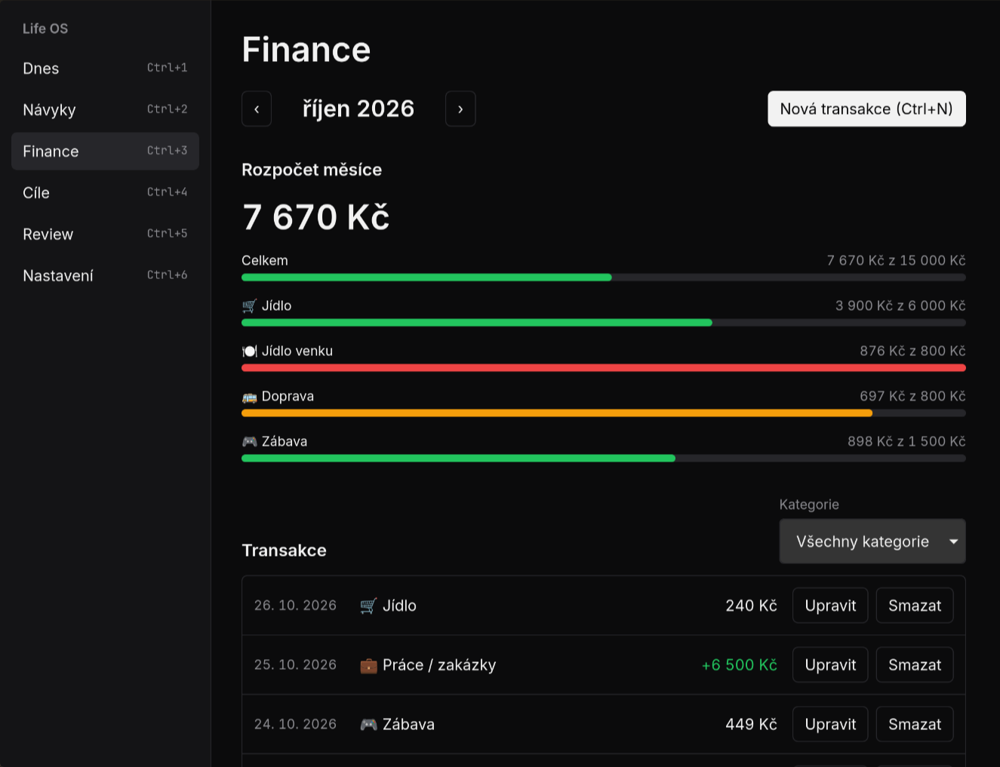

# Life OS

A local-first desktop app for habits and personal finance, built with Tauri 2, React, TypeScript and SQLite. One user, fully offline, Windows and Linux (including Hyprland). No server, no accounts, no telemetry. Your data stays on your disk.

Built in public as a learning project: getting better at building software with AI, one tested phase at a time.

## Why

I've tried habit apps before and quit for three reasons: I forgot to open them, logging felt like work, and one bad day wiped my streak. Life OS answers each one:

- It lives in the tray, starts on login and checks in twice a day (morning plan, evening wrap-up).
- Logging an expense or a habit takes under 5 seconds, keyboard first.
- "Never miss twice": a single missed day doesn't reset your streak.

It also answers one question every morning: how much can I spend today?

## Status

Phase 3 (habits, 0.3.0): habits from templates or your own, a monthly matrix where one click logs a day, streaks with the "never miss twice" rule, pauses, archive, at most 3 habits in the building phase and a notice when a habit becomes established. Phase 2 brought the finance basics: quick expense entry (Ctrl+N or the tray), monthly transactions and budget bars. Goals and the Today screen come next. The UI is Czech for now; English is planned after 1.0.



_Screenshot from made-up demo data (`npm run demo`)._

- Spec (Czech): [docs/PRD.md](docs/PRD.md)
- Roadmap: phases 0.1.0 → 1.0.0 in chapter 10 of the spec, plans in [docs/plans](docs/plans)

## Run it

Requirements: Node ≥ 22.13 (see `.nvmrc`), Rust stable, and the [Tauri prerequisites](https://tauri.app/start/prerequisites/) for your OS.

```bash
npm ci
npm run tauri dev       # development build, uses its own data folder
npm run build:release   # the version for real use: src-tauri/target/release/life-os
npm run demo            # replaces all dev transactions and limits with made-up data (never touches the real database)
npm run lint && npm test
```

Development and real data never mix: the default config uses the identifier `io.github.vladc3.lifeos.dev` ("Life OS Dev"), and only `npm run build:release` builds `io.github.vladc3.lifeos` ("Life OS"). The database lives in the app config folder (`~/.config/<identifier>` on Linux, `%APPDATA%\<identifier>` on Windows).

### Linux / Hyprland notes

- Blank window: run with `WEBKIT_DISABLE_DMABUF_RENDERER=1`.
- Tray icon needs a StatusNotifierItem host in your bar (Waybar `tray` module, Omarchy's shell has one).
- "Start after login" writes `~/.config/autostart/<name>.desktop`. Hyprland only runs it when the session supports XDG autostart (for example via uwsm). Otherwise add `exec-once` with the binary path to your Hyprland config.
- Closing the window hides Life OS to the tray; quit from the tray menu.
- On Linux the tray menu opens on right click (two-finger tap on a touchpad). Left click does nothing, Tauri's tray can't receive it there.
- Date fields show dates in your system's format (WebKitGTK follows the OS locale, e.g. `10/26/2026` with `LANG=en_US`). The app stores and lists dates the same way either way.

## License

[MIT](LICENSE)
